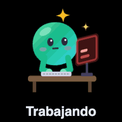
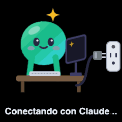

# HQ-nova

**Una Nova animada por cada agente de Claude Code.** Mira en vivo qué está haciendo cada uno: en el chat, en una pantalla grande con todas tus sesiones y, si quieres, en un cubo de escritorio.

<p>
  
  
</p>

> Nació como parte de **Nova**, la mascota e IA de **WmsPos**, de High Quality Computer and Security Inc.
>
> Es un mod para la app de escritorio de Claude Code, sin relación con Anthropic.

## Qué hace

**En el chat**
- Una franja encima del cuadro de texto con Nova en su oficina y una ayudante por cada subagente.
- Poses distintas según lo que hace: editar, leer, navegar, pensar, publicar, preguntarte algo…
- Barra de progreso, tiempo, archivos tocados y últimas acciones.
- Varita 🪄 cuando usa una skill, café ☕ en comandos largos y sudor 💦 en rachas de ediciones.
- Colores, ropa, escenarios, logo de tu empresa, sonidos y notificaciones.

**Pantalla grande** (`/nova pantalla`)
- Todas tus sesiones a la vez, cada una en su escritorio y con su color.
- Filtro Todos / Activos / Durmiendo.
- Al tocar un escritorio: su historial, la conversación, escribirle a ese chat y un botón para abrirlo en Claude.
- Horas con Claude y horas trabajando, por día y por sesión.

**Cubo de escritorio (opcional)**
- Un [GeekMagic HelloCubic-Lite](https://github.com/GeekMagicClock/HelloCubic-Lite) enseña a Nova en vivo, con 12 poses.
- Sin Claude abierto, Nova intenta enchufar su ordenador a la pared hasta que vuelves.
- Se configura en `⚙ Ajustes → 🧊 Cubo`.

## Cómo funciona

1. **La franja del chat** es un mod que escucha lo que hace Claude Code (herramientas, subagentes, turnos) y dibuja a cada agente en la pose que toca.
2. **La pantalla grande** es un servidor pequeño en tu ordenador. Lee los registros de tus chats (`~/.claude/projects`) y enseña la actividad de todas las sesiones en una página local.
3. **El cubo** recibe órdenes de ese mismo servidor por tu Wi‑Fi. Cada pose se dibuja una vez con Chrome como GIF de 240×240, se guarda en el cubo y después solo se le dice cuál enseñar. Si tienes un cubo configurado, el servidor arranca solo al abrir Claude, sin abrir el navegador.

Cada chat elige un color al abrirse y lo conserva: el primero lleva el color de tu Nova y los demás uno libre.

## Requisitos

- La app de escritorio de Claude Code, actualizada.
- [Node.js](https://nodejs.org) 22.13 o más nuevo, para la pantalla grande y el cubo. La franja del chat funciona sin Node.
- Para el cubo: Google Chrome, que dibuja las animaciones.

## Instalar

**Mac**

```bash
claude plugin marketplace add ericgutierre01/HQ-nova
claude plugin install nova-hq@hq-nova-ia
```

**Windows:** descarga el proyecto como .zip, descomprímelo y haz doble clic en `INSTALAR.cmd`. Crea un acceso directo a la pantalla grande en el escritorio. Se quita con `DESINSTALAR.cmd`.

Nova aparece en cada chat nuevo; en uno que ya tengas abierto, escribe `/reload-plugins`. La primera vez que abras la pantalla grande instalará sus librerías y tardará unos segundos más.

Si en Mac no tienes el comando `claude`, instala primero [Claude Code](https://claude.com/claude-code) para la terminal.

### Actualizar

```bash
claude plugin marketplace update hq-nova-ia
claude plugin update nova-hq@hq-nova-ia
```

En Windows, descarga la versión nueva y vuelve a abrir `INSTALAR.cmd`. Tus ajustes se conservan.

### Desinstalar

```bash
claude plugin uninstall nova-hq@hq-nova-ia
claude plugin marketplace remove hq-nova-ia
```

En Windows, `DESINSTALAR.cmd`.

## Configurar el cubo (opcional)

1. Enciende el cubo y anota la dirección que sale en su pantalla (por ejemplo `192.168.1.50`). Tiene que estar en la misma red que tu ordenador.
2. En Claude, abre `/nova ajustes`, pestaña **🧊 Cubo**.
3. Escribe la dirección y pulsa **Guardar y probar**.

En esa pestaña eliges qué Nova enseña (la del chat actual o la más importante de todos), su tamaño, el texto, el brillo y si se voltea. **Voltear** va activado porque el cristal del cubo se ve en espejo.

La primera vez, el cubo se queda en su álbum de fotos sin rotar, y las poses tardan como un minuto en prepararse. **↩ Devolver el cubo a como estaba** le pone otra vez su rotación y borra los dibujos de Nova; tus fotos no se tocan. Si no te caben las poses, borra alguna foto desde la página web del cubo.

## Comandos

| Comando | Qué hace |
|---|---|
| `/nova` | Vista grande de las Novas, al lado del chat |
| `/nova ajustes` | Color, ropa, oficina, franja, avisos y cubo |
| `/nova pantalla` | Abre la pantalla grande en tu navegador |
| `/nova pantalla playa pava rotar` | La abre con un escenario y una skin, rotando escenarios cada 10 min |
| `/nova pantalla apagar` | Apaga su servidor |
| `/nova skin pava` | Skins: clasica, pava, gorra, audifonos, lentes, corona, mago, navidad |
| `/nova escenario playa` | Ventanas: oficina, playa, espacio, ciudad, bosque, auto |
| `/nova color naranja` | Colores: nova, naranja, morado, rosa, azul, dorado, rojo, violeta, ambar, coral, lima |
| `/nova tamaño 80` | Alto de la franja en píxeles (20–200) |
| `/nova telescopio no` | Que no espíe mientras escribes (`si` para volver) |
| `/nova logo Mi Empresa` | Pone el nombre de tu empresa en una placa |
| `/nova logo ~/Desktop/logo.png` | Pone tu logo (PNG, JPG, SVG o WebP de hasta ~40 KB) |
| `/nova logo quitar` | Quita el logo |

En la pantalla grande, la tecla **S** cambia la skin y la **E** el escenario. La ventana ⓘ, junto a la franja, tiene una guía completa dentro de Claude.

## Problemas frecuentes

| Qué pasa | Qué hacer |
|---|---|
| No veo a Nova en un chat abierto | Escribe `/reload-plugins` |
| Nova desaparece al terminar una respuesta | Es el cuadro de pregunta de la app, que ocupa ese sitio; vuelve al cerrarlo |
| La pantalla grande no abre | Comprueba que tienes Node.js 22.13 o más nuevo; en Mac, mira `/tmp/nova-hq.log` |
| El cubo no responde | Comprueba su dirección con **Probar**; puede cambiar si reinicias el router |
| El cubo se queda en una pose vieja | El Mac se durmió o se apagó de golpe; se corrige al volver |

## Privacidad

- Todo se queda en tu ordenador: no hay cuentas, analítica ni servidores externos.
- La pantalla grande solo se abre desde tu propio ordenador (`127.0.0.1`).
- Tus horas y ajustes se guardan en `~/.claude/`, en archivos `nova-*.json`.
- El registro de horas y el chat desde la pantalla grande se pueden apagar en Ajustes.

**Aviso sobre el cubo:** el firmware de GeekMagic no tiene contraseña y su página `/config.json` muestra el nombre y la contraseña de tu Wi‑Fi a cualquiera conectado a tu red. No es cosa de este proyecto, pero conviene saberlo antes de ponerlo en una red compartida.

## Estado

Usado a diario en Mac. La parte de Windows viene de Kevyn y se ha probado menos; el cubo solo se ha probado en Mac (en Windows hay que indicar la ruta de Chrome en la variable `NOVA_CHROME`).

Para desarrollar, las pruebas se ejecutan con `claude plugin test mod`.

## Créditos

Creado por Eric Gutiérrez y Kevyn Mieses (la pantalla grande, las skins, los escenarios y el soporte de Windows), como parte de Nova, la mascota e IA de WmsPos, de High Quality Computer and Security Inc.

Licencia [MIT](LICENSE).
